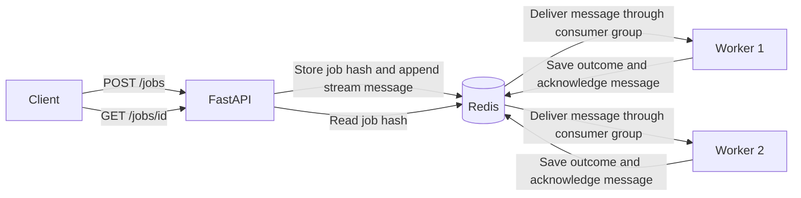

# Distributed Task Queue

A lightweight task queue built with Python, FastAPI, Redis Streams, and Docker Compose.

The API accepts jobs and returns a job ID immediately. Independent worker processes execute queued jobs and store their results in Redis. Clients retrieve job status and results through the API.

This project explores how background processing systems work, including job distribution, consumer groups, acknowledgments, and execution state tracking.

## Current Features

- Submit `sum_numbers` jobs through a REST API.
- Validate task names and arguments with Pydantic.
- Distribute jobs across independent workers using a Redis Streams consumer group.
- Track job status: `queued`, `running`, `succeeded`, or `failed`.
- Retrieve results, errors, attempt counts, and execution timestamps.
- Run multiple worker containers.
- Persist Redis data using append-only persistence and a Docker volume.
- Check API-to-Redis connectivity through a health endpoint.

## Architecture



### API

The API validates submissions, generates job IDs, and records jobs in Redis. It does not execute tasks itself.

### Redis

Redis serves two purposes:

- **Job records:** A hash at `job:<job_id>` stores the task, arguments, status, timestamps, and execution outcome.
- **Work distribution:** The `jobs` stream contains messages referencing job IDs.

Job creation writes the hash and stream entry in a Redis transaction. Transactions prevent other clients from interleaving commands, but Redis does not roll back commands that encounter execution errors.

### Workers

Workers share the `workers` consumer group. Redis distributes new stream messages among workers in that group.

Each worker processes one job at a time:

1. Read a stream message.
2. Load the job record.
3. Mark the job `running` and increment its attempt count.
4. Execute the registered task.
5. Record success or failure.
6. Acknowledge the stream message.

An acknowledgment removes a message from the group's pending tracking; it does not delete the stream entry.

The API and workers use the same application code but run as separate processes with different startup commands.

## Requirements

- Docker Engine and Docker Compose
- Docker Desktop running when using macOS or Windows

## Getting Started

Clone the repository and enter its directory:

```bash
git clone https://github.com/amroz76/Distributed-Task-Queue.git
cd Distributed-Task-Queue
```

Build and start the services:

```bash
docker compose up --build
```

The API is available at `http://localhost:8000`.

Interactive API documentation is available at `http://localhost:8000/docs`.

### Check Service Health

```bash
curl http://localhost:8000/health
```

Expected response:

```json
{
  "status": "ok",
  "redis": "connected"
}
```

The endpoint returns HTTP `503` if Redis cannot be reached.

### Submit a Job

```bash
curl -i -X POST http://localhost:8000/jobs \
  -H "Content-Type: application/json" \
  -d '{"task":"sum_numbers","args":{"numbers":[1,2,3]}}'
```

The API returns HTTP `202 Accepted`:

```json
{
  "id": "generated-job-id",
  "status": "queued"
}
```

Acceptance means the job has been recorded for processing. It does not mean execution has finished.

### Retrieve a Job

Replace `<job_id>` with the ID returned by submission:

```bash
curl "http://localhost:8000/jobs/<job_id>"
```

After successful execution, the response includes:

```json
{
  "id": "generated-job-id",
  "task": "sum_numbers",
  "args": {
    "numbers": [1.0, 2.0, 3.0]
  },
  "status": "succeeded",
  "attempts": 1,
  "created_at": "2026-11-13T04:14:33+00:00",
  "started_at": "2026-11-13T04:14:34+00:00",
  "finished_at": "2026-11-13T04:14:34+00:00",
  "worker_id": "worker-hostname",
  "result": 6.0,
  "error": null
}
```

IDs, timestamps, and worker names vary. The task is fast, so a client may observe `succeeded` without seeing the intermediate `running` state.

### Run Multiple Workers

```bash
docker compose up -d --build --scale worker=2
```

Each worker has its own consumer identity. Jobs can complete in a different order from submission, and distribution need not be perfectly even.

### View Worker Logs

```bash
docker compose logs worker
```

Follow only new log output:

```bash
docker compose logs --tail=0 -f worker
```

### Inspect Redis

View a job record:

```bash
docker compose exec redis redis-cli HGETALL "job:<job_id>"
```

View stream entries:

```bash
docker compose exec redis redis-cli XRANGE jobs - +
```

View pending message information:

```bash
docker compose exec redis redis-cli XPENDING jobs workers
```

### Stop the Application

```bash
docker compose down
```

The named Redis volume is retained, so stored jobs remain available when services restart.

To delete the application's stored Redis data as well:

```bash
# Destructive: removes the Compose project's Redis data volume.
docker compose down -v
```

## API Reference

| Method | Endpoint | Purpose |
|--------|----------|---------|
| GET | `/health` | Check Redis connectivity |
| POST | `/jobs` | Submit a supported task |
| GET | `/jobs/{job_id}` | Retrieve job status and outcome |

Invalid requests return HTTP `422`. A correctly formatted job ID that does not exist returns HTTP `404`.

## Project Structure

```text
app/
├── __init__.py
├── main.py       # API endpoints and Redis client lifecycle
├── models.py     # Request and response validation
├── storage.py    # Job storage and retrieval
├── tasks.py      # Registered task functions
└── worker.py     # Stream consumption and task execution
Dockerfile
compose.yaml
requirements.txt
README.md
```

## Design Choices

### Redis Streams

Streams provide ordered messages, consumer groups, and pending-message tracking. These primitives support worker coordination and provide a foundation for future crash recovery.

### Separate Job Records and Messages

The hash stores a job's current state. The stream message references that record and allows workers to discover work.

### Explicit Task Registry

Clients select from registered tasks rather than submitting executable Python code.

### Separate API and Worker Processes

HTTP handling and task execution can run and scale independently. Each worker executes one task at a time.

### Simple Demonstration Task

`sum_numbers` adds a list of numbers. It provides a predictable result for demonstrating the processing pipeline; the calculation itself does not require background execution.

## Current Limitations

This is a local development project, not a production-ready task queue.

- **Automatic retries are not implemented.** Task exceptions produce a terminal `failed` state.
- **Crash recovery is not implemented.** If a worker dies after claiming a message, that message can remain pending and the job can remain `running`.
- Workers currently read new messages; they do not reclaim abandoned pending messages.
- Redis connection failures can terminate a worker.
- Exactly-once execution is not guaranteed.
- Job records and stream entries have no automatic retention policy.
- Redis persistence does not guarantee zero data loss.
- The API has no authentication or rate limiting and should not be exposed to untrusted networks.
- No automated test suite or performance benchmarks are included yet.